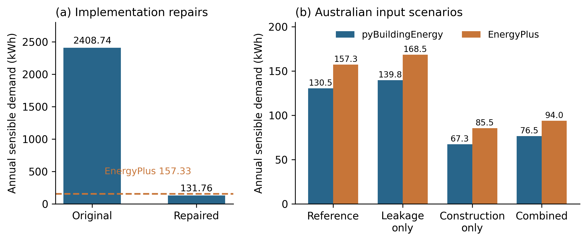
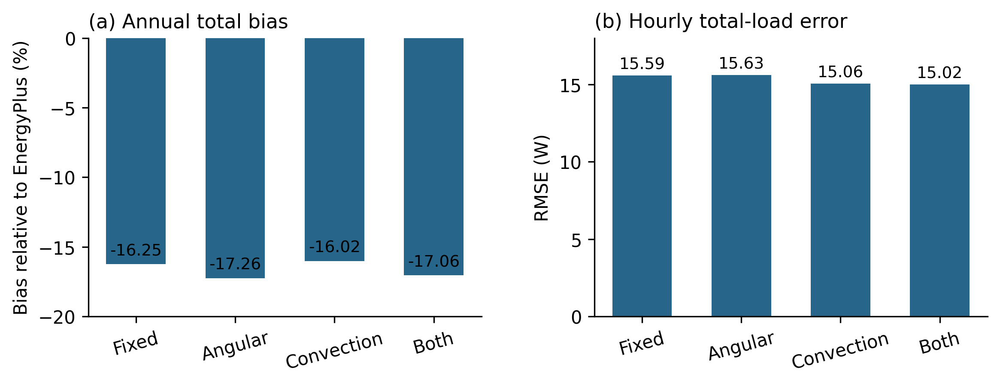
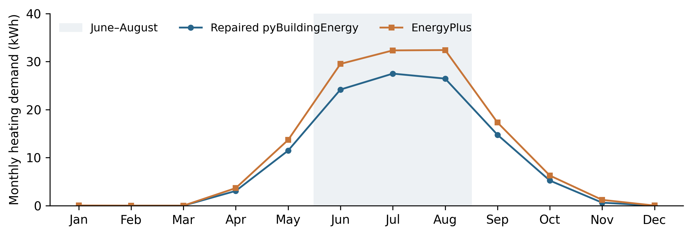

# 4 Results

The three-stage comparison separates implementation repairs, changes to solar transmission and exterior convection, and changes to Australian leakage and construction inputs. Twelve annual pyBuildingEnergy simulations and seven EnergyPlus 24.1.0 references were completed. All reported energies are sensible heating and cooling needs, rather than electricity consumption. Negative bias denotes underprediction relative to the corresponding EnergyPlus result.

Stages 1 and 2 use the diagnostic zero-capacity construction and the historical low-leakage assumption of q₅₀ = 4 m³/(h m²). Stage 3 changes permeability to the provisional 2006 default of 11 and introduces material-derived construction properties, separately and together. Weather-dependent infiltration is prescribed identically to both engines using a 20 °C reference temperature for the stack driver. EnergyPlus algorithms remain unchanged; a new reference is calculated when physical scenario inputs change.

Figure 1. Comparison design. Implementation repairs precede the physical-method comparison; both optional methods are retained for the Australian input scenarios. The leakage ablation is a diagnostic check, and individual annual effects are not isolated for every repair.

## 4.1 Implementation repairs

The original implementation predicted 2408.74 kWh of annual sensible demand against 157.33 kWh in the common EnergyPlus reference. After the implementation repairs, demand was 131.76 kWh. Annual total bias changed from +1430.98% to -16.25%, while hourly total-load RMSE fell from 483.24 to 15.59 W (Table 1). This reduction occurred before either optional physical modification was introduced.

Table 1. Implementation comparison against one EnergyPlus reference. Energy is kWh and RMSE is W. The infiltration-off case deliberately omits a pathway included in the reference.

| Configuration | Heating | Cooling | Total | Bias % | RMSE |
| --- | --- | --- | --- | --- | --- |
| Original | 1780.09 | 628.65 | 2408.74 | 1430.98 | 483.24 |
| Repaired without infiltration | 108.39 | 18.15 | 126.54 | -19.57 | 16.99 |
| Repaired | 113.22 | 18.54 | 131.76 | -16.25 | 15.59 |
| EnergyPlus | 136.38 | 20.95 | 157.33 | — | — |

The diagnostic records confirmed that annual internal gains decreased from 5341.22 to 728.18 kWh after repeated additions were removed. The original gain total was 7.33 times the repaired value. The original output also recorded 101.26 kWh of absolute ground heat flow for a dwelling with no ground contact; this quantity was zero after repair. These records identify errors in the represented gains and boundaries. They do not measure an equal reduction in conditioning demand, because the timing of gains, temperatures and thermostat operation affects the resulting heating and cooling.

In the controlled infiltration ablation, enabling the prescribed leakage flow increased heating by 4.83 kWh and cooling by 0.40 kWh, giving 5.23 kWh of additional sensible demand. The repaired airflow calculation used only the 13.5 m² outdoor-exposed envelope, and its hourly conductance matched the independently calculated ventilation-plus-infiltration series. This verifies inclusion of the airflow pathway without establishing the real apartment’s permeability.

The remaining repairs were assessed as a package. Focused checks supported internal-gain accounting, conditioned adjacency, ground-contact routing and heat-transfer calculations, but separate annual-demand effects were not assigned to every repair. The ground-season correction was inactive after ground-contact area was set to zero. The repaired model retained a substantial annual underprediction, so removal of the implementation faults did not establish equivalence with EnergyPlus.

Figure 2. Annual sensible demand. (a) Original and repaired implementations against the common EnergyPlus reference. (b) Australian input scenarios with their matched references. Panel scales differ; construction changes both resistance and capacity.

## 4.2 Angular transmittance and exterior convection

Table 2. Four physical-method combinations after implementation repairs. All use the same geometry, gains, airflow and EnergyPlus reference. Energy is kWh and RMSE is W.

| Configuration | Heating | Cooling | Total | Bias % | RMSE |
| --- | --- | --- | --- | --- | --- |
| Fixed methods | 113.22 | 18.54 | 131.76 | -16.25 | 15.59 |
| Angular only | 113.27 | 16.91 | 130.18 | -17.26 | 15.63 |
| Convection only | 112.08 | 20.04 | 132.12 | -16.02 | 15.06 |
| Both | 112.13 | 18.37 | 130.50 | -17.06 | 15.02 |

Angular transmittance alone reduced cooling by 1.63 kWh, from 18.54 to 16.91 kWh. Its heating effect was +0.05 kWh. Dynamic convection alone increased cooling by 1.50 kWh and changed heating by -1.14 kWh. The two cooling effects therefore acted in opposite directions.

With both modifications enabled, cooling was 18.37 kWh and total demand was 130.50 kWh. Absolute annual total bias increased from 16.25% to 17.06%. Dynamic convection alone produced the smallest absolute annual total bias of these four configurations, at 16.02%. The more detailed combined formulation therefore did not provide the closest annual result.

Hourly agreement gave a different ranking. Both modifications reduced total-load RMSE from 15.59 to 15.02 W. Heating RMSE changed from 13.16 to 13.51 W, while cooling RMSE changed from 8.37 to 6.55 W. Annual bias and hourly error should consequently be interpreted separately.

The monthly comparison located much of the heating difference in winter. June–August heating was 78.10 kWh in the repaired model and 94.21 kWh in EnergyPlus. The winter shortfall of 16.11 kWh accounted for 69.6% of the annual heating difference. The optional solar and convection changes therefore did not remove the underlying heating discrepancy.

Figure 3. Annual bias and hourly RMSE for the four physical-method combinations. Zero bias and lower RMSE indicate closer agreement. The combined methods reduce hourly error but do not minimise annual bias.

## 4.3 Australian leakage and construction inputs

Table 3. Four Australian input configurations. Both Stage 2 modifications are retained. Energy is kWh. Each row has a matched EnergyPlus reference; the construction change replaces diagnostic zero capacity with material-derived resistance and capacity.

| Configuration | ISO heat | ISO cool | ISO total | EP total | Bias % |
| --- | --- | --- | --- | --- | --- |
| Corrected reference | 112.13 | 18.37 | 130.50 | 157.33 | -17.06 |
| Australian leakage only | 120.73 | 19.06 | 139.78 | 168.49 | -17.04 |
| Australian construction only | 67.32 | 0.00 | 67.32 | 85.52 | -21.28 |
| Combined Australian inputs | 76.51 | 0.00 | 76.51 | 94.01 | -18.61 |

Increasing q₅₀ from 4 to 11 with diagnostic construction retained increased pyBuildingEnergy demand from 130.50 to 139.78 kWh, a rise of 9.29 kWh. The corresponding EnergyPlus total increased from 157.33 to 168.49 kWh. Leakage changed demand in both engines, while a discrepancy remained. The age-band input therefore affects the predicted load but does not by itself validate the leakage assumption or resolve the model difference.

At q₅₀ = 4, replacing the diagnostic construction with the illustrative material-derived construction decreased total demand by 63.17 kWh, to 67.32 kWh. The corresponding EnergyPlus total was 85.52 kWh. This comparison changes both resistance and heat storage. It cannot isolate the influence of thermal capacity alone, and the reference case is a diagnostic construction rather than a measured alternative dwelling.

The combined Australian input configuration predicted 76.51 kWh of heating and 0.00 kWh of cooling, giving 76.51 kWh in total against 94.01 kWh in EnergyPlus. Total annual bias was -18.61%, with hourly total-load RMSE of 20.29 W. Its absolute annual bias was larger than that of the corrected reference configuration. Because the physical scenarios differ, this change in bias is a scenario-dependent comparison, not an isolated improvement to the numerical method.

The combined demand change was not exactly the sum of the two separate changes. The interaction, calculated as combined minus leakage-only minus construction-only plus the reference result, was -0.10 kWh in pyBuildingEnergy. This difference reflects the dependence of leakage heat transfer and thermostat operation on the changed construction response.

The material-derived configuration retained the existing ISO capacity-class method. It did not use the earlier experimental layer-allocation extension. Consequently, the new results evaluate the effects of changed construction properties; they do not demonstrate improved representation of layer order. The material assemblies and neighbouring temperatures remain assumed case inputs.

## 4.4 Leakage sensitivity and airflow timing

Table 4. Leakage sensitivity with diagnostic construction and both physical modifications. Energy is kWh. Weather-flow cases share the same prescribed hourly multiplier.

| Scenario | ISO heat | ISO cool | EP heat | EP cool |
| --- | --- | --- | --- | --- |
| q₅₀ 11 weather flow | 120.73 | 19.06 | 146.83 | 21.66 |
| q₅₀ 14 weather flow | 124.51 | 19.35 | 151.51 | 21.95 |
| q₅₀ 11 constant flow | 119.81 | 18.87 | 145.50 | 21.48 |

At q₅₀ = 11, weather-dependent infiltration increased heating by 0.92 kWh relative to constant infiltration in pyBuildingEnergy. The annual mean multiplier was 0.853. Thus, annual mean airflow alone did not determine the heating response; the coincidence of leakage with outdoor temperature and heating operation also mattered. Raising q₅₀ from 11 to 14 changed total sensible demand by +4.08 kWh.

These leakage effects are conditional on the small outdoor-exposed envelope and continuous designed ventilation of 0.040 m³/s. They should not be generalised to detached dwellings or more exposed apartments. No measured airflow data were used to calibrate either permeability or the weather multiplier.

Figure 4. Monthly heating demand for the repaired implementation and its EnergyPlus reference. Shading identifies June–August, which accounts for 69.6% of the annual heating shortfall.

## 4.5 Numerical verification and interpretation

All eleven corrected annual runs produced 8760 finite hourly loads and passed the hourly energy-balance criterion of 10⁻⁶ W. The largest absolute residual was 9.19e-11 W. The transmission inventory resolved every surface: seven computational entries in the diagnostic model, where the identical windows were grouped, and eight in the construction model, where surfaces were retained separately. Ground heat flow remained zero. Independent checks verified the airflow conductance against the prescribed hourly multiplier and confirmed continuous ventilation in all seven EnergyPlus references.

A separate historical reproduction case, using q₅₀ = 14, constant infiltration and fixed physical methods, returned 124.46 kWh of heating and 19.30 kWh of cooling against 171.47 kWh in EnergyPlus. This reproduced the earlier results within their reported precision and was kept separate from the revised primary comparison. The existing test suite passed 240 checks with 17 skipped checks; nine additional checks passed for the revised age lookup, airflow and construction design.

Numerical consistency does not establish accuracy against a real building. The comparisons retain assumed neighbouring temperatures, glazing, ventilation and construction properties. The humidity diagnostic is excluded because a validated transient indoor moisture model is not available. The results support the verified implementation repairs and quantify the regional input sensitivities, while retaining the remaining disagreement with EnergyPlus.

# 5 Discussion

## 5.1 Implementation reliability before physical refinement

The main improvement arose from repairing the implementation rather than adding more detailed physical methods. Under the common diagnostic scenario, the original annual sensible demand of 2408.74 kWh fell to 131.76 kWh after repair, compared with 157.33 kWh in EnergyPlus. The accompanying reduction in hourly RMSE from 483.24 to 15.59 W indicates that the change affected agreement throughout the year, as well as the annual total. These findings support checking the accounting of gains, boundaries and heat-transfer pathways before interpreting differences as limitations of the simplified model formulation.

The diagnostic evidence makes the corrections physically interpretable. Repeated internal-gain additions inflated the gain total, while ground heat flow was calculated for an apartment with no ground contact. Removing these inconsistencies ensures that the model represents the intended apartment more faithfully. However, the decrease in internal gains cannot be equated directly with the decrease in heating or cooling demand. Thermostat operation and the timing of heat gains influence how these quantities are related. Most repairs were also evaluated together, so the annual improvement cannot be divided reliably among individual corrections. The infiltration ablation provides a separate annual effect, whereas the remaining checks establish correct behaviour without quantifying each repair’s independent contribution.

The repaired implementation therefore provides a more defensible basis for further development, but it does not achieve equivalence with EnergyPlus. Its remaining annual underprediction of 16.25% is material and should be retained when describing the model’s performance. Energy-balance closure and successful software tests establish numerical consistency; they do not establish that the assumed building inputs or predicted loads are correct for an occupied dwelling.

## 5.2 Physical detail and the choice of performance metric

The angular-transmittance and exterior-convection comparisons show why annual and hourly performance must be assessed separately. Angular transmittance reduced cooling, whereas dynamic convection increased it under the tested conditions. Their combined effect on annual cooling was consequently smaller than either effect alone. This partial cancellation helps explain why a limited change in the annual total does not mean that the added methods were inactive.

With both methods enabled, total-load RMSE decreased from 15.59 to 15.02 W, while the magnitude of annual bias increased from 16.25% to 17.06%. The hourly improvement was also uneven: cooling RMSE decreased, but heating RMSE increased. The evidence therefore supports a modest improvement in the aggregate hourly comparison, rather than a general improvement across all performance measures. Retaining both methods in the Australian scenarios allows their joint behaviour to be assessed consistently; it should not be presented as proof that this combination is optimal.

The winter concentration of the heating shortfall provides a useful direction for further diagnosis. June–August accounted for 69.6% of the repaired model’s annual heating difference. This pattern identifies when disagreement is greatest, but does not isolate its cause. Further controlled comparisons could examine the treatment of neighbouring temperatures, heat-transfer coefficients, thermostat response and construction properties. Changing these factors together to match an annual total would obscure which mechanism explains the difference.

## 5.3 Interpretation of the Australian adaptations

The Australian adaptations primarily change the physical inputs represented by the model. Increasing the provisional leakage parameter from q₅₀ = 4 to 11 m³/(h m²) increased annual demand in both engines, but left their relative disagreement almost unchanged. This distinguishes the effect of representing a leakier envelope from an improvement in the calculation method. The construction-year lookup provides a reproducible way to select an assumed input; without measured permeability, it cannot establish that the selected value describes this apartment or the wider Australian housing stock.

Weather-dependent infiltration offers a way to examine the timing of leakage alongside outdoor conditions. At q₅₀ = 11, the prescribed weather-dependent flow increased heating by 0.92 kWh relative to constant flow, despite an annual mean multiplier below one. This result is consistent with the importance of when airflow occurs relative to heating operation. However, this comparison changes both the annual mean and the hourly pattern of airflow, so it does not isolate a pure timing effect. A further comparison using a constant flow equal to the weather-dependent annual mean would separate these influences more clearly.

The common airflow prescription was designed to control the comparison between engines. It uses a fixed 20 °C reference for the stack driver and the same hourly multiplier in both models. The results therefore assess responses to matched prescribed airflow, rather than validating a fully coupled airflow model driven by each engine’s simulated indoor temperature. They also do not isolate a wind-only contribution or demonstrate performance under extreme wind conditions. The relatively small leakage effect is specific to the limited outdoor-exposed envelope and the prescribed continuous ventilation in this apartment; it does not establish that leakage is unimportant in other dwelling types.

The construction comparison produced a larger demand change than the tested leakage change, but its interpretation requires similar care. The transition from diagnostic zero-capacity construction to illustrative material-derived properties changes both resistance and heat storage. The reduction cannot be attributed to thermal mass alone or interpreted as the energy saving from a particular retrofit. The existing ISO capacity-class method was retained, so these runs also provide no evidence of improved representation of material layer order. Zero predicted cooling in the construction cases is a result of the assumed scenario and model response, rather than evidence that comparable apartments would never require cooling.

With both Australian inputs applied, pyBuildingEnergy predicted 76.51 kWh against 94.01 kWh in EnergyPlus, an underprediction of 18.61%. Because each physical scenario has its own matched reference, these comparisons reveal how agreement changes with the inputs. They do not show a progressive improvement in accuracy from one scenario to the next. The combined case demonstrates that the regional inputs can be represented within the workflow while leaving a substantial discrepancy to be investigated.

## 5.4 Scope and priorities for further evaluation

The study provides a controlled comparison for one apartment and one weather dataset. Neighbouring temperatures, construction assemblies, glazing and ventilation remain assumed inputs, and the early stages deliberately use a diagnostic construction. These choices support the investigation of implementation behaviour but limit direct interpretation of the absolute loads as representative Australian residential demand. The reported quantities are sensible heating and cooling needs, not metered electricity use; equipment efficiency and a validated transient moisture model are outside the present comparison.

EnergyPlus serves as a computational reference rather than an observation of the building. Agreement with it is useful for identifying differences between implementations, but empirical validation requires measured conditions and demand. The present study also does not quantify uncertainty in the assumed inputs, assess peak-load accuracy separately, or establish a computational-speed advantage. Claims about operational prediction, equipment sizing or reliable real-time deployment would therefore exceed the evidence presented here.

Further work should prioritise separate ablations for the remaining implementation repairs, matched-mean airflow comparisons, and construction experiments that vary resistance and capacity independently. Measurements of permeability, neighbouring conditions and indoor temperatures would help constrain the case inputs. Evaluation across additional dwelling forms and climates would then test whether the remaining bias is systematic or specific to this apartment. Such comparisons should retain separate heating and cooling metrics, annual bias and hourly error, so that improvements in one measure do not conceal deterioration in another.

# 6 Conclusion

This study evaluated pyBuildingEnergy through implementation repairs, optional physical-method changes, and Australian leakage and construction inputs, using twelve annual simulations and seven matched EnergyPlus references. The largest improvement occurred after the implementation repairs: annual total bias changed from +1430.98% to −16.25%, and hourly total-load RMSE decreased from 483.24 to 15.59 W. Diagnostic checks supported the removal of repeated internal gains and inappropriate ground heat flow, while the corrected runs satisfied the numerical energy-balance criterion.

Additional physical detail produced mixed outcomes. Combining angular transmittance and dynamic exterior convection reduced total-load RMSE to 15.02 W but increased the magnitude of annual bias to 17.06%. The Australian input comparisons showed sensitivity to both leakage and construction properties without resolving the discrepancy between engines. The combined configuration predicted 76.51 kWh of sensible demand against 94.01 kWh in EnergyPlus, remaining 18.61% lower.

The contribution is a corrected, reproducible implementation and a controlled framework for distinguishing software repairs, physical-method effects and regional input assumptions. The results do not establish general validation for Australian housing or equivalence with EnergyPlus. The revised model provides a basis for further comparative research, with measured-input validation and broader case testing needed before stronger claims about predictive accuracy can be made.
